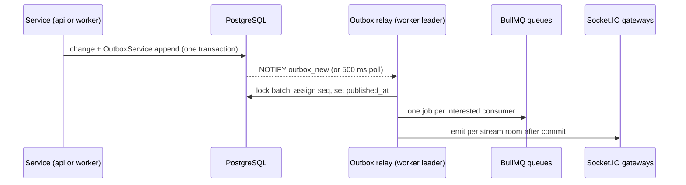

ReplyX is a TypeScript monorepo (pnpm workspaces, Turborepo) with three apps:

| App | Path | What it is |
|---|---|---|
| API | `apps/api` | NestJS on Node, PostgreSQL 17 through Kysely, Valkey (Redis) for BullMQ, Socket.IO fan-out and rate limits |
| Web | `apps/web` | React and MUI single-page app built with Vite; one bundle, three lazily loaded areas |
| Docs | `apps/docs` | This site: Fumadocs on Next.js, exported as static files |

The API contract is `apps/api/openapi.yaml`. The web app never calls `fetch` for API data itself:
it uses a client generated from the spec with orval (`apps/web/src/api/generated`, regenerated by
`scripts/generate-api-client.sh`) wrapped by React Query hooks in `apps/web/src/data`.

## Two processes, one codebase

`AppModule.forRoot({ role })` (`apps/api/src/app.module.ts`) builds the same code into two
processes:

| Process | Entry | Runs |
|---|---|---|
| `api` | `src/main.api.ts` | HTTP controllers, guards, validation and the Socket.IO gateway |
| `worker` | `src/main.worker.ts` | The outbox relay, BullMQ consumers and processors, timers (sweepers) |

Shared modules (database, outbox writer, domain services) load in both. Anything slow or
event-driven (notifications, email, SLA timers, automation, webhooks, search indexing, AI turns)
runs in the worker, never inside a request.

## Modules

Each folder under `apps/api/src` is a module with its own controllers, services and repositories:

| Module | Owns |
|---|---|
| `tenancy` | Tenants, provisioning, settings, suspension, retention jobs, the dev seed |
| `identity` | Staff and customer sign-in, sessions, invitations, password reset, erasure |
| `authorization` | The permission registry, roles, group access, `PolicyService` |
| `groups`, `tags`, `views`, `macros` | Desk configuration |
| `tickets` | Tickets, the state machine, history, merge and split, the timer sweeper |
| `messaging` | Messages and notes, the customer conversation and its projection, attachments binding |
| `attachments` | Uploads, scanning, signed download links |
| `routing` | Routing rules for new tickets and automation rules (`routing/automation`) |
| `sla` | SLA policies, business hours, due times and breaches |
| `notifications` | In-app, push and email notifications and preferences |
| `search`, `dashboard`, `customers`, `satisfaction`, `audit` | Read models and their APIs |
| `integrations` | Webhooks ([Webhooks](/developers/webhooks/)) |
| `ai` | AI Assist: drafts, replies, routing, policies |

A module calls another module's exported service, never its tables. Permissions are declared
per module with `definePermissions` and checked with `@RequirePermission` (see
[Authorization](/developers/authorization/)).

## The platform kernel

`apps/api/src/platform-kernel` holds what every module builds on:

| Folder | Provides |
|---|---|
| `db/` | `UnitOfWork`, `TenantContext`, `TenantRepository`, the migrator and table types |
| `outbox/` | `OutboxService` (append in the caller's transaction), the event map, the relay |
| `jobs/` | Queues, `IdempotentHandler` for event consumers, `JobProcessor` for named jobs |
| `realtime/` | The Socket.IO gateway, rooms, `sync` catch-up, presence |
| `http/` | `AppError` and the error filter, the Zod validation pipe, cursor pagination, CSRF, rate limits, the outbound guard |
| `crypto/` | `SecretBox` (AES-256-GCM) for tenant secrets |
| `mail/`, `observability/`, `redis/` | Email sending, logging, metrics and health, Redis clients |
| `clock.ts` | `Clock`, the only source of "now" (tests and the dev clock replace it) |

## Tenant isolation

Every tenant-owned table has a `tenant_id` and **forced** row-level security. Migrations call
`enable_tenant_rls(table)` (`apps/api/migrations/0001_helpers.ts`), which adds one policy:
`tenant_id = NULLIF(current_setting('app.tenant_id', true), '')::uuid`. The runtime role
`replyx_app` has no `BYPASSRLS` and gets table privileges only through `grant_app_dml`.

The tenant comes from the request's `Host` header (`tenant-resolver.middleware.ts`), never from a
body or path. Code reaches tenant data in three layers:

1. **`UnitOfWork.withTenant(ctx, fn)`** (`db/unit-of-work.ts`) opens a transaction and sets
   `app.tenant_id` with `SET LOCAL`, so the setting ends with the transaction even on a pooled
   connection. `withTenantReadOnly` also makes the transaction read-only.
2. **`TenantRepository`** (`db/tenant-repository.ts`) adds `tenant_id = :tenant` to every select,
   update and delete it builds, sets it on every insert, and refuses a transaction opened for
   another tenant.
3. **RLS** is the backstop: a query that forgets both still sees only the tenant's rows, and with
   no tenant set it sees none.

Global tables (`tenants`, `platform_operators`, `permission_definitions`) are reached through a
separate `replyx_platform` pool. Every route that takes an id is covered by the generated
cross-tenant suite (`apps/api/test/cross-tenant`), which fails when a route has no fixture.

## Events: outbox, relay and jobs

A change and its event commit together:

- `OutboxService.append` writes the event with its streams (`ticket:{id}`, `tickets:group:{id}`,
  `user:{id}`, `conversation:{customerId}`…) and, for customer streams, a customer projection
  without ticket fields.
- The relay (`outbox/relay.ts`) runs in one worker at a time (an advisory lock). It gives each
  event a gap-free `seq`, queues a job per consumer (job ids are deduplicated) and emits to rooms
  only after commit.
- Consumers extend `IdempotentHandler` (`jobs/idempotent-handler.ts`): each event is claimed in
  `processed_events` inside the consumer's own tenant transaction, so a redelivery does nothing.
  Failed jobs retry with backoff and land in a dead-letter queue.
- Timers (pending dates, auto-close, SLA, automation time rules, webhook recovery) are repeatable
  jobs that sweep active tenants.

## Real-time

The gateway (`realtime/gateway.ts`) serves Socket.IO on `/rt`: staff on namespace `/`, customers on
`/customer`. The handshake authenticates the session cookie against the host's tenant. Rooms are
`t:{tenantId}:{stream}`; staff join the group rooms they may view, customers only their own
conversation. When access changes, the gateway recomputes rooms. Clients keep the last `seq` they
saw and call `sync` after a reconnect to replay what they missed (published events are kept 7
days). With several `api` processes, Valkey carries emits between them.

## Web app

`apps/web/src/routes` splits the app into three areas, each a lazy chunk:

| Area | Where | Audience |
|---|---|---|
| Customer | `/` on a tenant host | Customers: the chat, never ticket concepts |
| Workspace | `/desk` on a tenant host | Staff: inbox, tickets, views, admin |
| Console | `console.` host | Platform operators |

Shared UI lives in `src/components` (foundations, shell, data display, inputs, builders, chat).
Data hooks in `src/data` wrap the generated client, map errors and apply real-time events to the
React Query cache.

## Production

Production runs the same images with Docker Compose behind Caddy on a single VM; see
[Deployment](/developers/deployment/). To run everything locally, see
[Local development](/developers/local-development/).
