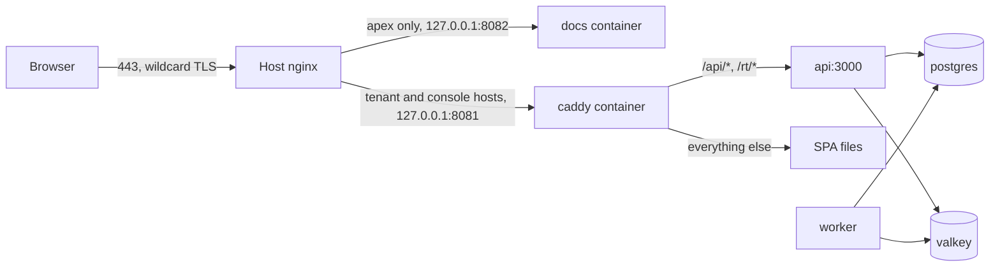

The production stack runs on one VM that also hosts other sites. Images are built on the VM from a
git checkout (no registry), TLS is terminated by the host nginx with one wildcard certificate, and
backups are a nightly local dump only. Examples use `replyx.example.com` as the base domain
(`<base>`); replace it with your own domain in `infra/.env.prod` and `infra/nginx/replyx.conf`.

## Shape of the deployment



- `infra/compose.prod.yml` defines the stack (project name `replyx`). Only `caddy` and `docs` publish
  a port, and only on loopback: `127.0.0.1:${CADDY_PORT:-8081}` and `127.0.0.1:${DOCS_PORT:-8082}`.
  Postgres, Valkey and ClamAV are reachable inside the compose network only.
- `infra/nginx/replyx.conf` is the host nginx site. It redirects 80 to 443 for every host
  and has two 443 blocks:
  - `server_name replyx.example.com` (the apex) proxies to the docs container on `127.0.0.1:8082`.
  - `server_name *.replyx.example.com` (tenants and the console) proxies to `127.0.0.1:8081` with
    `Host` unchanged (the api resolves the tenant from it), overwrites `X-Forwarded-For`, and answers
    404 for `/health/`.
- `infra/caddy/Caddyfile` is an internal HTTP-only server: it serves the SPA, proxies `/api/*` and
  `/rt/*` to the api, and adds security headers. It does no TLS.
- `apps/docs/Caddyfile` is the docs container's server: static files only, with its own headers. See
  [The docs site](#the-docs-site).

## VM prerequisites

- Docker with Compose v2 (`docker compose`), and a user that may run `docker`.
- A host nginx and certbot already installed.
- About 2-3 GB of free RAM for the stack (more with ClamAV, see below).
- `127.0.0.1:8081` and `127.0.0.1:8082` free (or set `CADDY_PORT` and `DOCS_PORT` in
  `infra/.env.prod` and edit the nginx site to match).
- `git`, `curl` and `openssl` (used by the scripts).

## DNS

Create two A records pointing at the VM's public address:

| Name | Purpose |
|------|---------|
| `<base>` | Apex: the docs site |
| `*.<base>` | Tenants (`<slug>.<base>`) and the operator console (`console.<base>`) |

## Wildcard certificate

Wildcards need the DNS-01 challenge:

```bash
sudo certbot certonly --manual --preferred-challenges dns \
  -d <base> -d '*.<base>'
```

certbot prints two values. Add both as TXT records named `_acme-challenge.<base>`, wait for DNS to
propagate, then continue. Keep the certificate name equal to `<base>`, because the nginx site reads
`/etc/letsencrypt/live/<base>/fullchain.pem`.

### Renewal is manual

A `--manual` certificate cannot renew unattended, and the renewal config deliberately has no auth
hook. The certbot timer therefore fails fast on it instead of hanging on a prompt. Renew by hand
before expiry (every 90 days; `sudo certbot certificates` shows the date) by issuing it again under
the same name:

```bash
sudo certbot certonly --manual --preferred-challenges dns --cert-name <base> \
  -d <base> -d '*.<base>'
sudo nginx -t && sudo systemctl reload nginx
```

Replace the old TXT records with the two new values when certbot asks. To automate it, set up a certbot DNS-provider plugin
or an API auth hook for the DNS provider, then renewals work without intervention.

## Install the nginx site

Obtain the certificate first: `nginx -t` fails while the certificate files are missing.

When replacing an installed site, compare it with the repo first. If the live file has changes that
are not in the repo, keep a dated backup before copying:

```bash
diff /etc/nginx/sites-available/replyx.example.com infra/nginx/replyx.conf
sudo cp /etc/nginx/sites-available/replyx.example.com   /etc/nginx/sites-available/replyx.example.com.bak-$(date +%F)
```

Then install it:

```bash
sudo cp infra/nginx/replyx.conf /etc/nginx/sites-available/replyx.example.com
sudo ln -s /etc/nginx/sites-available/replyx.example.com /etc/nginx/sites-enabled/
sudo nginx -t && sudo systemctl reload nginx
```

Never reload without a passing `nginx -t`: other sites share this nginx. For a different base
domain, copy the file and replace the domain in `server_name` and the certificate paths. Names such
as `log_format` and the shared memory zone carry a `replyx` prefix because they are global in the
`http{}` context.

## Firewall

Allow only SSH, HTTP and HTTPS inbound: 22, 80 and 443. The stack's own ports stay on loopback or
inside the compose network.

## First setup

1. Clone the repository into `~/replyx` and change into it.
2. Create the environment file. The script writes `infra/.env.prod` with mode 600 and random secrets,
   and refuses to overwrite an existing file:

   ```bash
   OPERATOR_EMAIL=you@example.com bash infra/scripts/init-env.sh
   ```

   `OPERATOR_EMAIL` is optional; it sets `OPERATOR_BOOTSTRAP_EMAIL`.
3. Edit `infra/.env.prod` (template: `infra/.env.prod.example`):
   - `BASE_DOMAIN` and `CONSOLE_HOST` for your domain.
   - `SMTP_HOST`, `SMTP_PORT`, `SMTP_USER`, `SMTP_PASS`, `SMTP_FROM`. **Email does not work until
     these are set**: invitations, password resets and sign-in links are not delivered while
     `SMTP_HOST` is still `smtp.example.com`. `deploy.sh` warns about this.
   - AI Assist: `AI_PROVIDER=openrouter` and `COMMERCE_PROVIDER=spree` (the defaults in the
     template). The `fake` providers are refused in production. Tenants bring their own OpenRouter and
     Spree keys in the app; nothing provider-specific goes in this file. `OPENROUTER_BASE_URL` stays
     `https://openrouter.ai` unless you route through a proxy.
   - Malware scanning, pick one. `SCAN_DISABLED=true` is the current default on this small host:
     attachments are marked clean without being scanned. To scan, set `CLAMAV_HOST=clamav:3310`
     (and `SCAN_DISABLED=false`); `deploy.sh` then starts the `clamav` service (compose profile
     `scan`, roughly 1.5-2 GB more RAM). In production the worker refuses to start with neither.
4. Deploy (next section).

Database role passwords are applied only when `infra/postgres/init.sql` first runs on an empty
volume. Changing one later in `infra/.env.prod` does not change it inside an existing database.
`REPLYX_SECRETS_KEY` (64 hex characters, generated by `init-env.sh`) must never change: it seals
every tenant's AI provider and store keys and webhook signing secrets (`apps/api/src/platform-kernel/crypto/secret-box.ts`). If it changes, the
saved keys can no longer be opened, and tenants must enter them again. Keep it in your backups
alongside the database dump.

## Deploying

```bash
bash infra/scripts/deploy.sh [git-ref]
```

From the repo root, `infra/scripts/deploy.sh`:

1. Validates `infra/.env.prod` (no `__GENERATE_` placeholders) and refuses tracked local changes.
2. With no ref, runs `git pull --ff-only`; with a ref (commit, tag or branch), fetches and checks it
   out detached.
3. Tags images with the 12-character commit id and builds them on the VM.
4. If postgres is already running, takes a pre-deploy dump (`pg-backup.sh once`).
5. Starts postgres and creates the superuser-only `vector` extension (pgvector, used by AI
   Assist) if it is missing. The owner role that runs migrations cannot create it.
6. Runs the one-off `migrate` service as `replyx_owner`, then `docker compose up -d`.
7. Polls `http://127.0.0.1:8081/health/ready` for up to 3 minutes. On failure it prints the api log
   tail and the command to roll back.
8. Polls the docs site on `http://127.0.0.1:${DOCS_PORT:-8082}/` for up to 1 minute, with the same
   log tail and rollback hint on failure.

## Rollback

Run the same command with an older ref, for example the previous commit the script printed:

```bash
bash infra/scripts/deploy.sh <older-ref>
```

This leaves the checkout on a detached HEAD; run `git switch main` before the next plain deploy.
Old image tags stay on disk for a quick rollback (`docker image ls 'replyx-*'`, prune with
`docker rmi`).

Migrations are forward-only. Rolling back across a schema change needs a restore from the
pre-deploy dump (see Backups) before or after redeploying the older ref.

## The docs site

The docs (`apps/docs`, a Fumadocs site) are a static export served on the apex host,
`https://<base>/`, by their own container.

- **Image**: `apps/docs/Dockerfile` builds the site with `pnpm --filter docs build` (Next.js
  `output: 'export'`) in a Node stage and copies `apps/docs/out` into a `caddy:2` image. `deploy.sh`
  builds it with the rest of the stack, tagged `replyx-docs:<commit>`.
- **Service**: `docs` in `infra/compose.prod.yml`, with `mem_limit: 64m` (Caddy serving static files
  uses about 20 MB), published on `127.0.0.1:${DOCS_PORT:-8082}` and health-checked with `wget`.
  `DOCS_PORT` defaults to `8082` in `infra/.env.prod.example`; if you change it, change the apex
  block's `proxy_pass` too.
- **nginx**: the apex 443 block proxies everything to the docs container. Tenant and console hosts
  never reach it, and the apex never reaches the app.
- **Serving** (`apps/docs/Caddyfile`): `try_files {path} {path}/index.html`, so `/guides/triage` and
  `/guides/triage/` both work (search results link without the slash). Unknown paths get
  `/404.html` with status 404. Files under `/_next/static/` are cached for a year (`immutable`, their
  names are content hashes); everything else is `no-cache`.

### Why the docs CSP differs

The docs host sends the same headers as the app (HSTS, `nosniff`, `X-Frame-Options: DENY`,
`Referrer-Policy`, `Permissions-Policy`) with a stricter CSP in most ways (`form-action 'none'`, no
`connect-src` beyond `'self'`, no `blob:`). The one relaxation is `script-src 'self' 'unsafe-inline'`:
a Next.js static export writes inline `<script>` tags on every page, and the theme script must run
inline before paint to avoid a flash of the wrong theme. Per-page hashes would need a post-build
rewrite of every HTML file that breaks silently when Next changes its output.

The risk is low because the docs host has no cookies, sessions, forms or user content. App cookies
are host-only (no `domain` is set), so the apex can't read tenant sessions. This deviation is
recorded in `specs/003-product-docs-site/plan.md` (Complexity Tracking).

### Rolling back the docs

The docs deploy with the app, so the normal [rollback](#rollback) (`deploy.sh <older-ref>`) also
rolls back the docs. To roll back only the docs to an image still on disk, without touching the app:

```bash
docker image ls replyx-docs
IMAGE_TAG=<older-tag> docker compose -p replyx -f infra/compose.prod.yml --env-file infra/.env.prod   up -d --no-deps --no-build docs
```

To take the docs off the apex entirely, restore the previous nginx site from its `.bak-` copy, then
`sudo nginx -t && sudo systemctl reload nginx`.

## Operator bootstrap and the first tenant

While no platform operator exists, the api creates one at startup from `OPERATOR_BOOTSTRAP_EMAIL`
and `OPERATOR_BOOTSTRAP_PASSWORD` in `infra/.env.prod`. Sign in at `https://console.<base>`, change
the password, then blank both variables and redeploy. Create the first tenant from the console; its
workspace lives at `https://<slug>.<base>`. See [Tenants](/operators/tenants/) for the console
workflow.

These slugs are reserved and rejected (`RESERVED_SLUGS` in
`apps/api/src/platform-kernel/http/tenant-resolver.middleware.ts`): `console`, `api`, `www`,
`admin`, `static`, `internal`, `mail`.

## Backups

The `backup` service runs `infra/scripts/pg-backup.sh loop`: a custom-format `pg_dump` every day at
`BACKUP_HOUR_UTC` (default 3) into the `replyx-backups` volume, keeping the newest `BACKUP_KEEP`
(default 14). It dumps as the `postgres` superuser because tenant tables use forced row-level
security and any other role would dump no rows.

List dumps:

```bash
docker compose -p replyx -f infra/compose.prod.yml --env-file infra/.env.prod \
  run --rm --no-deps backup ls -lh /backups
```

Restore into an empty `replyx` database (roles come from `infra/postgres/init.sql` on a fresh
volume), using a dump file from that volume:

```bash
pg_restore -h postgres -U postgres -d replyx --clean --if-exists <file>.dump
```

Run it from a container on the compose network, for example the `backup` service image with
`docker compose ... run --rm --no-deps backup bash`, then stop `api` and `worker` first.

Limits today: dumps live on the same VM, so they do not protect against losing the VM. Off-VM copies
(T203) are not set up yet, and uploaded files (`replyx-files` volume) are not backed up.

## Troubleshooting

Logs and status:

```bash
docker compose -p replyx -f infra/compose.prod.yml --env-file infra/.env.prod logs --tail 100 api
docker compose -p replyx -f infra/compose.prod.yml --env-file infra/.env.prod ps
```

Replace `api` with `worker`, `migrate`, `caddy`, `docs` or `postgres`. Add `--profile scan` if ClamAV is
enabled.

| Symptom | Check |
|---------|-------|
| `/health/ready` returns 404 from outside | Expected. It is reachable only on the VM: `curl -i http://127.0.0.1:8081/health/ready`. nginx answers 404 for `/health/`, and caddy serves it only to requests without `X-Forwarded-For`. |
| `nginx -t` fails on certificate files | Obtain the certificate first; the name must match `<base>`. |
| Browser certificate warning on a tenant host | The certificate must cover `*.<base>`; check the TXT records and `sudo certbot certificates`. |
| Worker exits at start | Neither `CLAMAV_HOST` nor `SCAN_DISABLED=true` is set. |
| Port 8081 already in use | Set `CADDY_PORT` and update `proxy_pass` in the nginx site. |
| Port 8082 already in use | Set `DOCS_PORT` and update the apex block's `proxy_pass` in the nginx site. |
| The apex shows the app, or a tenant host shows the docs | The installed nginx site is older than the repo's: the apex needs its own `server_name <base>` block, and the app block must be `*.<base>` only. |
| `deploy.sh` says the docs site did not answer | Check `docker compose ... logs docs`; on the VM, `curl -I http://127.0.0.1:8082/` should return 200. |
| No emails arrive | `SMTP_*` still placeholders; check the worker logs. |
| Migration `0017_ai` fails with `type "vector" does not exist` | The `vector` extension was not created. `deploy.sh` creates it as `postgres` before migrating; on a hand-run migration, run `CREATE EXTENSION IF NOT EXISTS vector WITH SCHEMA public` as `postgres` first. The image must be `pgvector/pgvector:0.8.7-pg17-trixie`. |
| api or worker exits with "REPLYX_SECRETS_KEY must be set to 64 hex characters" | The key is missing or malformed in `infra/.env.prod`. |
| Every tenant's AI calls fail after a deploy, while key tests and turns log decryption errors | `REPLYX_SECRETS_KEY` changed, so the saved keys no longer open. Restore the previous value. |
